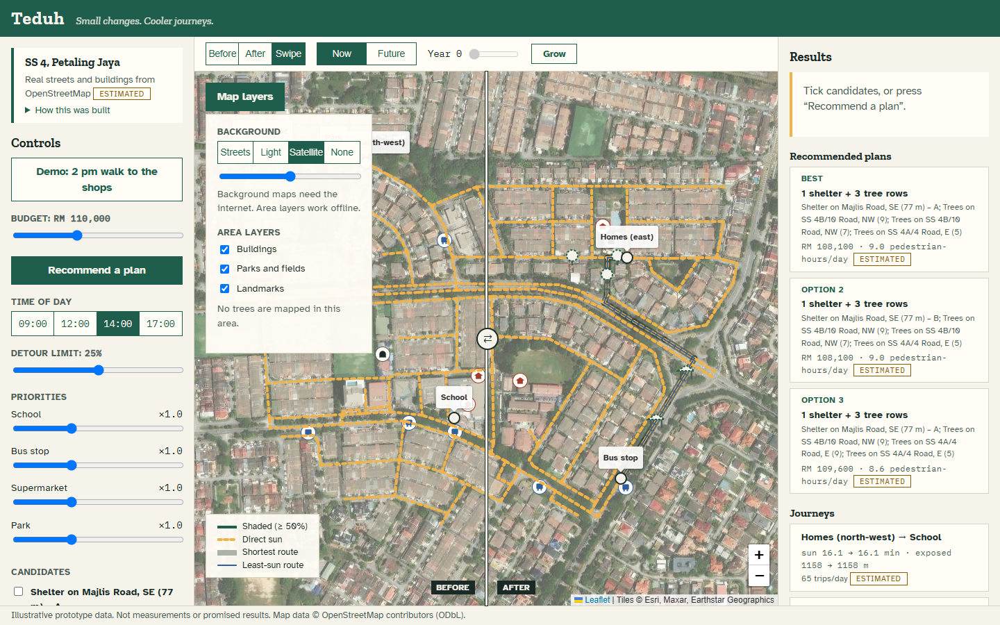

# TEDUH — Build Spec

> **Small changes. Cooler journeys.**
> A map that helps township managers choose where to add trees or shelters so everyday walks get more shade, within a budget.

- Product brief & feature ranking: [`BRIEF.md`](BRIEF.md)
- Team roles, branches, timeline: [`PLAN.md`](PLAN.md)

## Quick start

```bash
npm install
npm run dev            # app on http://localhost:5173
npm run dev:server     # optional: AI scan + explainer API on :8787 (second terminal)
npm run test && npm run build
npm run build && npm run preview   # production build; works offline except map tiles
```

- Copy `.env.example` to `.env`. Set `VITE_ENABLE_AI=true` to show the AI panels. With no `ANTHROPIC_API_KEY` the server returns clearly labelled **mock** results, so the demo never depends on the network.
- Click **Demo: 2 pm walk to the shops** to load the demo scenario.
- The app uses real OpenStreetMap data for SS 4, Petaling Jaya (`data/osm/`). Set `VITE_DATASET=seed` for the invented offline dataset. Refreshing or changing the area is described in `data/README.md`.
- Pitch material is in `pitch/`.

## Screenshots

Real streets, buildings and places from OpenStreetMap for SS 4, Petaling Jaya. Shade, trips and costs are **modelled estimates** (see "How this was built" in the app). Regenerate with `npm run screenshots` (needs both dev servers running; it also checks the main features work).

**Before / After swipe.** Drag the divider to compare the surveyed network with the recommended plan. The amber dashed lines are paths in direct sun.


**See the area.** "Map layers" switches the background (Streets, Light, Satellite, None) and shows buildings, parks, mapped trees and landmarks. The area layers work offline.



**Now / Future canopy.** Young trees give little shade today and a lot at maturity, so the best plan changes with the growth year.


**Fabrication pack.** Click a shelter or tree marker for its dimensions, bill of materials, elevation drawing and CSV/JSON export. Output is indicative only.


**AI shade scan.** A survey photo gets a shade estimate that only reaches the map after a person confirms it. The sample photo here is a placeholder, and without an API key the estimate is a labelled MOCK.


**Plan explainer.** A written summary built only from numbers the calculator produced.


---

## 0. Instructions for Claude (read first)

You are building a **hackathon prototype**. **Deadline: Tue 20 Oct 2026; demo freeze Mon 19 Oct noon** (schedule in `PLAN.md` §4). Optimise for a **reliable, explainable live demo**, not for production scale.

1. **Work phase by phase** (Section 9). Do not start the next phase until the current one meets its acceptance criteria.
2. At the end of each phase, run `npm run test` and `npm run build`. Then **STOP** and print:
   - what was built,
   - anything skipped or stubbed,
   - a suggested commit message (conventional commits, e.g. `feat(routing): add least-sun route with detour limit`).
3. **Do NOT run `git commit`, `git push`, or create branches.** The human commits.
4. **Do NOT edit files owned by teammates** (Section 3) except to create their initial stubs in Phase 0.
5. Treat `src/types.ts` as the shared contract. Change it only on `main`, and list every change in your phase summary so teammates can pull.
6. Ask before adding any dependency not listed in Section 2.
7. Keep functions < 50 lines and files < 400 lines. Use immutable updates and no `console.log` left in code. Use named constants, not magic numbers.
8. All maths lives in **pure functions** in `src/lib/` with Vitest tests (target ≥ 80% coverage for `src/lib/`).
9. Never write UI copy that claims temperature reduction, health or safety benefits (see Section 10).

If you are a **teammate's** Claude working on a branch, skip to **Section 11** for your task.

---

## 1. What we're building (Tier 0 + Tier 1)

| Area | Feature |
|---|---|
| Map | One neighbourhood: 20–40 path segments, ~5 destinations, shaded (green) vs sun (amber) |
| Routing | Shortest route vs least-sun route, with a detour limit |
| Simulator | 6–10 candidate interventions; budget slider; destination priority weights; recommends best plan + 2 alternatives |
| Results | Walk time, sun-minutes, longest exposed stretch, install + maintenance cost, confidence labels, journeys that benefit |
| **Map Restoration** | Before / After / **Swipe** map modes; **Now / Future canopy** toggle + growth slider; time-of-day selector |
| **Fabrication** (Teammate A) | Spec pack per intervention: BOM, dimensions, cost, SVG elevation, CSV/JSON export |
| **AI Reconstruction** (Teammate B, Tier 2) | Survey photo → Claude vision shade estimate → human confirm → map updates |

Tier 3 (do **not** build unless asked): sun-position shadow sim, 3D view, generative photo renders, DXF export, resident QR page.

---

## 2. Tech stack

| Concern | Choice | Why |
|---|---|---|
| Build | **Vite + React + TypeScript** (strict) | Fast, simple, no backend needed for core |
| Map | **Leaflet + react-leaflet**, OSM tiles | Light, well-known, works with GeoJSON |
| State | **Zustand** | Tiny, avoids prop drilling, immutable updates |
| Validation | **zod** | Validate `data/*.json` at load and AI responses |
| Tests | **Vitest** (+ `@vitest/coverage-v8`) | Same toolchain as Vite |
| AI server (Teammate B) | **Hono** on Node (`server/`), **`@anthropic-ai/sdk`** | Keeps API key off the client |
| Styling | Plain CSS with custom properties (CSS modules OK) | No UI-kit look |

Use current stable versions. Node ≥ 20.

**Scripts** (`package.json`):
```
dev         vite
dev:server  tsx watch server/index.ts
build       tsc -b && vite build
preview     vite preview
test        vitest run
test:watch  vitest
coverage    vitest run --coverage
```
Vite dev server proxies `/api` → `http://localhost:8787`.

---

## 3. Project structure & ownership

```
teduh/
├── README.md                     (Evan)
├── BRIEF.md, PLAN.md             (Evan)
├── .env.example                  ANTHROPIC_API_KEY=, VITE_ENABLE_AI=false
├── data/                         ── Teammate C ──
│   ├── neighbourhood.json        nodes, segments, destinations
│   ├── interventions.json        candidate trees / shelters
│   ├── journeys.json             origin→destination trips per day
│   └── unit-costs.json           fabrication unit costs (shared with A)
├── pitch/                        ── Teammate C ── slides, demo script, photos
├── server/                       ── Teammate B ──
│   └── index.ts                  Hono app: GET /api/health, POST /api/shade-scan, POST /api/explain
└── src/
    ├── main.tsx, App.tsx         (Evan)
    ├── config.ts                 constants & feature flags (Evan)
    ├── types.ts                  ★ SHARED CONTRACT (Evan only)
    ├── data/load.ts              zod schemas + loaders (Evan)
    ├── lib/                      (Evan) pure logic + tests
    │   ├── geo.ts                haversine, segment length
    │   ├── graph.ts              build adjacency from segments
    │   ├── shade.ts              effective shade per segment (time, canopy, interventions)
    │   ├── routing.ts            dijkstra, shortestRoute, leastSunRoute
    │   ├── metrics.ts            walkMin, sunMin, longestExposedM
    │   ├── optimizer.ts          enumerate subsets, score, top-3 plans, contributions
    │   └── *.test.ts
    ├── store/scenario.ts         Zustand store (Evan)
    ├── components/               (Evan)
    │   ├── MapView.tsx           Leaflet map, segment layers, markers
    │   ├── SwipeCompare.tsx      before/after clip divider
    │   ├── ControlsPanel.tsx     budget, time, canopy, detour, priorities, candidates
    │   ├── ResultsPanel.tsx      metrics, plan list, confidence
    │   └── JourneyList.tsx
    ├── features/
    │   ├── fabrication/          ── Teammate A ──
    │   │   ├── index.ts          export { FabricationPanel }
    │   │   ├── FabricationPanel.tsx
    │   │   ├── spec.ts           generateShelterSpec, generateTreeSpec (pure)
    │   │   ├── export.ts         toCsv, toJson, download helpers
    │   │   ├── elevation.ts      shelter SVG string (pure)
    │   │   └── *.test.ts
    │   └── ai-scan/              ── Teammate B ──
    │       ├── index.ts          export { ShadeScanPanel, PlanExplainer }
    │       ├── ShadeScanPanel.tsx
    │       ├── PlanExplainer.tsx
    │       ├── client.ts         fetch /api/*, zod-validate response
    │       └── *.test.ts
    └── styles/tokens.css, global.css
```

`App.tsx` imports `FabricationPanel`, `ShadeScanPanel` and `PlanExplainer` **only via `src/features/*/index.ts`**. In Phase 0 these are stubs that render a small "Coming soon" card, so teammates replace the stub internals without touching `App.tsx`.

---

## 4. Shared contract — `src/types.ts`

Create exactly this in Phase 0 (add fields only if needed, and report them).

```ts
export type DataSource = 'surveyed' | 'estimated' | 'ai-confirmed' | 'missing';
export type TimeSlot = '09:00' | '12:00' | '14:00' | '17:00';
export type CanopyMode = 'now' | 'future';
export type MapMode = 'before' | 'after' | 'swipe';

export interface PathNode { id: string; lat: number; lng: number; label?: string }

export interface PathSegment {
  id: string;
  from: string;                       // PathNode.id
  to: string;                         // PathNode.id
  lengthM?: number;                   // computed from coords if absent
  widthM: number;                     // footpath width, used by fabrication
  shade: Record<TimeSlot, number>;    // 0..1 fraction shaded, survey snapshot
  shadeSource: DataSource;
  accessible: boolean;                // false = blocked, excluded from routing
  notes?: string;
}

export type DestinationKind = 'home' | 'school' | 'bus-stop' | 'shops' | 'clinic' | 'park';
export interface Destination { id: string; nodeId: string; name: string; kind: DestinationKind }

export interface Journey {
  id: string;
  originId: string;                   // Destination.id (kind 'home')
  destinationId: string;              // Destination.id
  dailyTrips: number;
  tripsSource: DataSource;
}

export type InterventionType = 'tree' | 'shelter';
export type Feasibility = 'approved' | 'likely' | 'needs-check';

export interface Intervention {
  id: string;
  type: InterventionType;
  name: string;
  segmentIds: string[];               // segments it shades
  installCost: number;                // MYR
  annualMaintenance: number;          // MYR / year
  shadeNow: number;                   // 0..1 shade on day 1
  shadeFuture: number;                // 0..1 shade at maturity
  yearsToMature: number;              // shelter 0, tree ~5–8
  feasibility: Feasibility;
  costSource: DataSource;
}

export interface Scenario {
  budget: number;
  time: TimeSlot;
  canopy: CanopyMode;
  canopyYear: number;                 // 0..10, drives growth slider
  detourLimit: number;                // 0.25 = up to 25% longer than shortest
  priorityWeights: Record<string, number>; // Destination.id -> multiplier (default 1)
  selectedInterventionIds: string[];
  mapMode: MapMode;
}

export interface RouteResult {
  journeyId: string;
  segmentIds: string[];
  lengthM: number;
  walkMin: number;
  sunMin: number;
  longestExposedM: number;
}

export interface JourneyComparison { journeyId: string; before: RouteResult; after: RouteResult }

export interface PlanResult {
  interventionIds: string[];
  installCost: number;
  annualMaintenance: number;
  sunMinutesAvoidedPerDay: number;    // Σ trips × weight × (sunBefore − sunAfter)
  journeys: JourneyComparison[];
  journeysImproved: string[];
  contributions: Record<string, number>; // interventionId -> marginal minutes avoided
}

// ---- Fabrication (Teammate A implements, contract fixed here) ----
export interface BomLine { item: string; qty: number; unit: string; unitCost: number; total: number }
export interface FabricationSpec {
  interventionId: string;
  type: InterventionType;
  dimensions: Record<string, number>; // e.g. lengthM, widthM, heightM, modules
  bom: BomLine[];
  totalCost: number;
  assumptions: string[];
  disclaimer: string;
  elevationSvg?: string;
}

// ---- AI scan (Teammate B implements, contract fixed here) ----
export interface ShadeScanResult {
  segmentId: string;
  shadeFraction: number;              // 0..1
  shadeSources: string[];             // e.g. ['tree canopy', 'shop awning']
  obstacles: string[];                // e.g. ['parked motorcycle on path']
  confidence: 'low' | 'medium' | 'high';
  notes: string;
  isMock: boolean;
}
export interface ShadeOverride { segmentId: string; time: TimeSlot; shade: number; source: 'ai-confirmed' }
```

The store also keeps `shadeOverrides: ShadeOverride[]`, plus actions `applyShadeOverride(o)` and `selectIntervention(id | null)` (for the fabrication panel).

---

## 5. Core algorithms (`src/lib/`)

Constants in `src/config.ts`:
```ts
WALK_SPEED_M_PER_MIN = 72      // 1.2 m/s
EXPOSED_THRESHOLD   = 0.5      // segment counts as "exposed" if effective shade < 0.5
DEFAULT_DETOUR      = 0.25
MAX_CANDIDATES      = 12       // 2^12 subsets is still instant
LAMBDA_SWEEP        = [10, 5, 3, 2, 1, 0.5, 0]
TREE_GROWTH_CURVE   = smoothstep(canopyYear / yearsToMature)
```

**Effective shade** (`shade.ts`) for segment *s* at time *t*:
```
base = override(s,t) ?? s.shade[t]
for each selected intervention i covering s:
    iShade = canopy==='now' ? i.shadeNow
           : lerp(i.shadeNow, i.shadeFuture, growth(canopyYear, i.yearsToMature))
    base = max(base, iShade)
```
Shelters: `shadeNow == shadeFuture`, so the canopy toggle doesn't change them, which is the point of the toggle.

**Metrics** (`metrics.ts`) along a route:
- `walkMin = Σ length / WALK_SPEED`
- `sunMin = Σ length × (1 − effShade) / WALK_SPEED`
- `longestExposedM` = longest run of consecutive segments with `effShade < EXPOSED_THRESHOLD`, summing their lengths

**Routing** (`routing.ts`), undirected graph, `accessible === false` excluded:
- `shortestRoute`: Dijkstra on `length`.
- `leastSunRoute`: for λ in `LAMBDA_SWEEP`, Dijkstra on `length + λ × length × (1 − effShade)`. Return the first route with `length ≤ shortest × (1 + detourLimit)`. λ = 0 equals shortest, so it always terminates. This is simple, inspectable, and easy to explain to judges.

**Optimizer** (`optimizer.ts`):
1. Enumerate every subset of candidate interventions with `Σ installCost ≤ budget` (bitmask loop).
2. For each subset, for each journey, compute `leastSunRoute` **before** (no interventions) and **after** (subset applied).
3. `score = Σ dailyTrips × priorityWeight(dest) × (sunBefore − sunAfter)`. Tie-break: lower install cost, then lower max longestExposedM.
4. Return the top 3 `PlanResult`s. For the best plan, compute `contributions[i]` = score(best) − score(best \ {i}).
5. Overlaps are counted once automatically, because each journey is recomputed with the combined shade (no double counting).
6. Memoise "before" routes per (time, canopy, overrides). Target is < 300 ms for 10 candidates × 15 journeys. If slower, run in a Web Worker.

**Tests (must exist):** haversine sanity; Dijkstra on a hand-made 5-node graph; detour limit respected; λ sweep falls back to shortest; longest-exposed-run edge cases (empty, all shaded, all exposed); shade max/lerp; optimizer respects budget, picks the shared-connector shelter in the seed scenario, contributions sum sensibly; zod rejects bad data.

---

## 6. Seed data (Phase 0, replaced later by Teammate C)

> **Update:** the invented dataset now lives in `data/seed/` (used by the tests and `VITE_DATASET=seed`). The app defaults to real OpenStreetMap data in `data/osm/`; see `data/README.md`.

Generate a **synthetic but believable** neighbourhood around `MAP_CENTER` in `src/config.ts` (placeholder Malaysian township coordinate; Teammate C will set the real one):

- ~30 segments on a loose grid (40–120 m each), 5 destinations: **Home cluster A, Home cluster B, School, Bus stop, Shop row**.
- Journeys: both home clusters → each of school, bus stop, shops (6 journeys, 40–300 trips/day).
- Shade snapshots vary by time. 14:00 is the harshest.
- **Design the "memorable moment":** one ~240 m exposed **shared connector** that sits on the least-sun route of the school, bus-stop *and* shop journeys. A single shelter there (≈ RM 18k) should be the top recommendation at a modest budget.
- 8 candidates: 3 shelters, 5 trees (tree: `shadeNow` 0.15–0.25, `shadeFuture` 0.7–0.85, `yearsToMature` 5–8).
- Target the demo numbers in BRIEF §7 (2 pm to shops: ~10 walk-min both ways, sun-min 6 → 2, longest exposed 240 m → 60 m).
- Label everything `estimated`. Add a basemap opacity control and a "hide basemap" toggle, since synthetic paths won't align with OSM streets.

---

## 7. UI

**Layout (desktop first, must not break at 1024 px):**
```
┌──────────────┬──────────────────────────────────┬────────────────┐
│ Controls     │  Map  [Before | After | Swipe]   │ Results        │
│ budget       │       [Now ◯ Future] year ▭      │ sun-min avoided│
│ time  ⏱      │                                   │ per journey Δ  │
│ detour       │   green = shade, amber = sun      │ cost / upkeep  │
│ priorities   │   tree/shelter markers            │ plan 1/2/3     │
│ candidates ☐ │                                   │ confidence     │
│ [Recommend]  │                                   │ ── Fabrication │
│ [Demo preset]│                                   │ ── AI scan     │
└──────────────┴──────────────────────────────────┴────────────────┘
```

- **Swipe:** render "before" and "after" segment layers into two Leaflet panes. Clip the after pane with CSS `clip-path: inset(0 0 0 X px)` driven by a draggable vertical handle. No plugin.
- Exposed segments are **dashed** as well as amber, so colour isn't the only signal.
- Clicking a segment shows a popup with shade per time, source label, and length.
- Clicking an intervention selects it and opens the Fabrication panel.
- Changing any control recalculates in < 1 s.
- **Demo preset button** sets time 14:00, journey Home A → Shops, and budget RM 25k, then runs Recommend.

**Design direction:** "field survey notebook". Use deep canopy green `#1F5D4C`, sun amber `#EFB34A`, paper `#F6F3EA` and ink `#1B2A26`. Headings in a characterful serif (e.g. *Fraunces*), body in *Inter*, numbers in a tabular mono. Big numbers for the headline metric ("**42 pedestrian-hours in direct sun avoided / day**"). Tokens in `src/styles/tokens.css`. Avoid a generic dashboard look.

---

## 8. Feature flags & env

```
VITE_ENABLE_AI=false        # hides AI scan + explainer when false
ANTHROPIC_API_KEY=          # server only, never VITE_-prefixed
```
`.env` is git-ignored, and `.env.example` is committed.

---

## 9. Phases for `main` (Evan)

| Phase | Build | Acceptance criteria | Suggested commit |
|---|---|---|---|
| **P0** Scaffold | Vite app, deps, structure (Section 3), `types.ts`, `config.ts`, zod loaders, seed data (Section 6), **stub** `features/fabrication` + `features/ai-scan` + `server/index.ts` (health route), `.env.example`, `.gitignore`, `.gitattributes` (`* text=auto eol=lf`), empty app shell with 3 columns | `npm run dev` shows shell; `npm run test` passes (1 smoke test); `npm run build` passes | `chore: scaffold project, contracts, stubs and seed data` |
| **P1** Engine | `geo`, `graph`, `shade`, `routing`, `metrics` + tests | All Section 5 routing/metrics tests pass; coverage ≥ 80% on these files | `feat(lib): add routing, shade and route metrics` |
| **P2** Map | `MapView`, segment colouring by time, destinations, route comparison for selected journey (shortest vs least-sun), segment popups | Selecting a journey draws both routes; changing time recolours map | `feat(map): render network and compare routes` |
| **P3** Simulator | `optimizer` + tests, Zustand store, `ControlsPanel`, `ResultsPanel`, `JourneyList`, intervention markers | Recommend returns top-3 within budget; seed shared-connector shelter wins; toggling a candidate recalculates | `feat(sim): add budget optimizer and results panel` |
| **P4** Map Restoration | Before/After/Swipe modes, Now/Future toggle + year slider, time selector wired to everything | Swipe visibly closes the gap; Future raises tree shade, shelters unchanged | `feat(map): add before/after swipe and canopy growth` |
| **P5** Integrate | Wire `selectIntervention` → Fabrication panel; `applyShadeOverride` → map; demo preset; confidence labels everywhere | Teammate features work in-app after merge; preset loads in one click | `feat: integrate fabrication and ai scan, add demo preset` |
| **P6** Polish | Empty/error states, loading, keyboard focus styles, 1024 px check, `npm run preview` offline check | Section 7 + PLAN §7 checklist all ticked | `chore: demo polish` |

---

## 10. Honesty guardrails (UI copy & pitch)

- Never say shade lowers temperature by X°, or that a route is "safe" or "healthy".
- Every metric shows its source badge: `surveyed` · `estimated` · `ai-confirmed` · `missing`.
- Fabrication output footer: *"Indicative only. Requires qualified engineer sign-off and site/utility checks."*
- AI results are never applied without a human "Confirm" click, and mock responses show a visible **MOCK** badge.
- The demo footer says: *"Illustrative prototype data. Not measurements or promised results."*

---

## 11. Branch tasks (teammates — give your Claude this README + your section)

**Rules for every branch:** only edit your owned folders (Section 3). Don't touch `src/types.ts`, `App.tsx` or `src/lib/`. Import types from `src/types.ts`. Keep your `index.ts` export names unchanged. Run `npm run test && npm run build` before pushing. Don't commit; the human does.

### 11A. `feat/fabrication` — Fabrication Data (Teammate A)

Goal: when an intervention is selected, show a **Fabrication pack** a contractor could quote from.

- `spec.ts` (pure, tested):
  - `generateShelterSpec(intervention, segments, unitCosts): FabricationSpec`
    - length = Σ covered segment lengths; width = max segment `widthM` + 0.3 m overhang
    - modules of `MODULE_LENGTH_M = 3`; posts = (modules + 1) × 2; footings = posts
    - roof area = length × width; gutter length = length × 2
    - BOM lines: steel posts, rafters/purlins, roof sheet (m²), footings (concrete m³), fixings, labour (days), contingency 10%
  - `generateTreeSpec(intervention, unitCosts)`: pit 1.2 × 1.2 × 1.0 m, soil mix m³, root barrier m, tree guard, stakes, sapling, 2-year watering/maintenance plan. Suggested species come from `data/unit-costs.json` (`speciesSuggestions`, each flagged `verify: true`).
  - Every spec includes `assumptions[]` and the disclaimer from Section 10.
- `elevation.ts`: `shelterElevationSvg(spec): string` is a side elevation with posts, roof line, and dimension labels (length, height 2.7 m, module spacing). It is pure string output, so it's testable.
- `export.ts`: `toCsv(spec)`, `toJson(spec)`, `downloadFile(name, content, mime)`.
- `FabricationPanel.tsx`: reads the selected intervention from the store; shows dimensions, BOM table, total, elevation SVG, and buttons **Download CSV** / **Download JSON**. When nothing is selected it shows "Select a shelter or tree on the map".
- Until `data/unit-costs.json` arrives from Teammate C, use a local default constant with the same shape.
- Tests: module/post counts for 0, 3, 10, 240 m; BOM totals add up; CSV has a header + one row per BOM line; SVG contains the expected number of posts.

### 11B. `feat/ai-scan` — AI Reconstruction (Teammate B)

Goal: turn a survey photo into a **human-confirmed** shade value on the map.

- `server/index.ts` (Hono, port 8787):
  - `GET /api/health`
  - `POST /api/shade-scan` with multipart `{ image, segmentId, time }`. Validate the image type (jpeg/png/webp) and size (≤ 5 MB). Call Claude via `@anthropic-ai/sdk` with model `claude-sonnet-5-5`, sending the image as a base64 image block plus a prompt that asks for **JSON only** matching `ShadeScanResult` (minus `isMock`). Validate the response with zod. On a missing key, an API error or invalid JSON, return a **mock** result with `isMock: true` and a reason, without crashing.
  - `POST /api/explain` with body `PlanResult`. Ask Claude for a 4–6 sentence manager-facing summary that **only uses the numbers provided**, states assumptions, and makes no temperature/health claims.
  - Read the key from `process.env.ANTHROPIC_API_KEY` and never log it. Add a simple in-memory rate limit (e.g. 20 req/min).
  - Use the `claude-api` skill / current Anthropic SDK docs for exact request shapes.
- `client.ts`: typed fetchers with zod validation and user-friendly error messages.
- `ShadeScanPanel.tsx`: pick segment + time → upload photo → show preview, estimated shade %, sources, obstacles, confidence, and a **MOCK** badge if applicable → slider to adjust → **Confirm** calls the store's `applyShadeOverride`. The map then re-colours and results recalculate.
- `PlanExplainer.tsx`: an "Explain this plan" button that renders the summary, with a "Generated from the numbers above" caption.
- Everything is hidden when `VITE_ENABLE_AI !== 'true'`.
- Tests: zod schema accepts good and rejects bad responses; client handles a 500 → friendly error; server falls back to mock without a key.

### 11C. `feat/data-pitch` — Real data & pitch (Teammate C)

- Replace `data/*.json` with the surveyed neighbourhood. Same schema; `npm run test` must still pass, since the zod loaders validate it.
  - Trace paths in geojson.io, then convert to nodes/segments. Record shade at 09:00/12:00/14:00/17:00 as 0, 0.25, 0.5, 0.75 or 1. Mark `shadeSource: 'surveyed'`.
  - Use real candidate locations only where a tree or shelter could physically go. Rough costs are labelled `estimated`.
  - Set `MAP_CENTER` value in a note for Evan, since `config.ts` is his file.
- `data/unit-costs.json`: unit costs for fabrication BOM + `speciesSuggestions` (`{ name, matureCanopyM, yearsToMature, verify: true }`).
- `pitch/`: slides (problem → demo → differentiation vs Undercover → pilot plan → honesty), the 3-minute demo script following BRIEF §7, 3–5 resident quotes, and photos.
