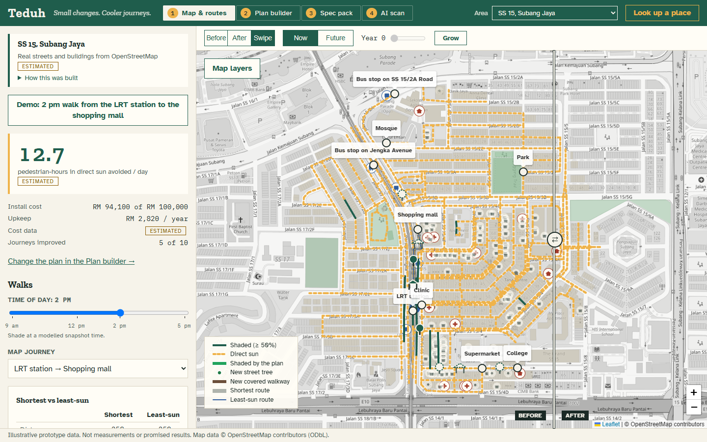
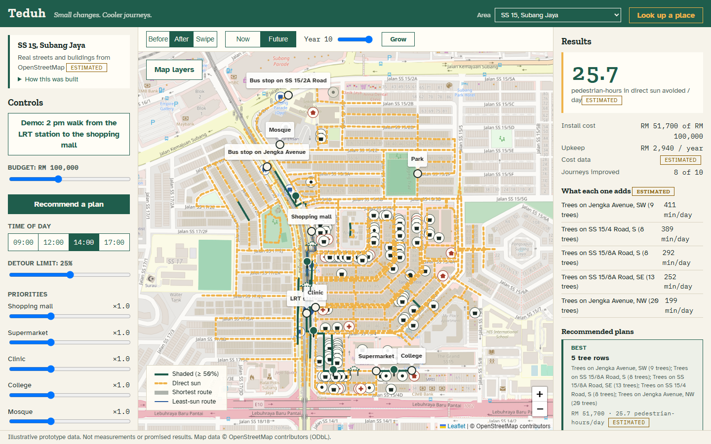
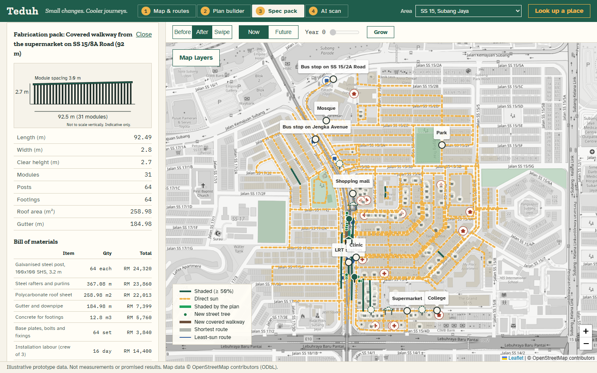
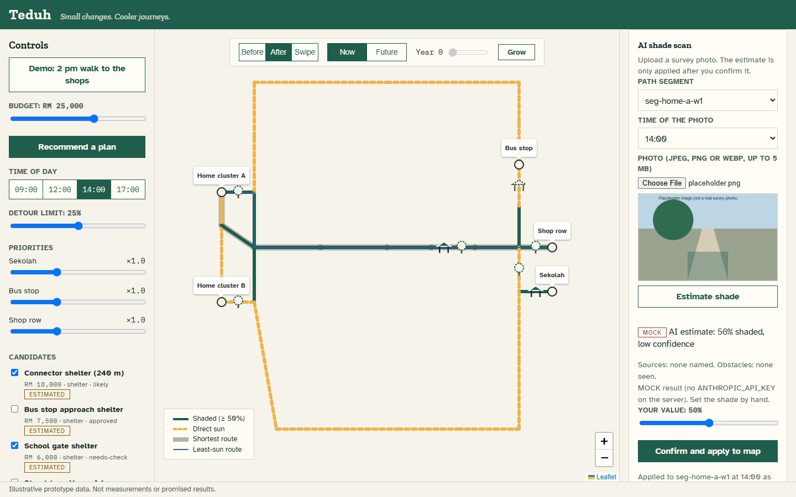
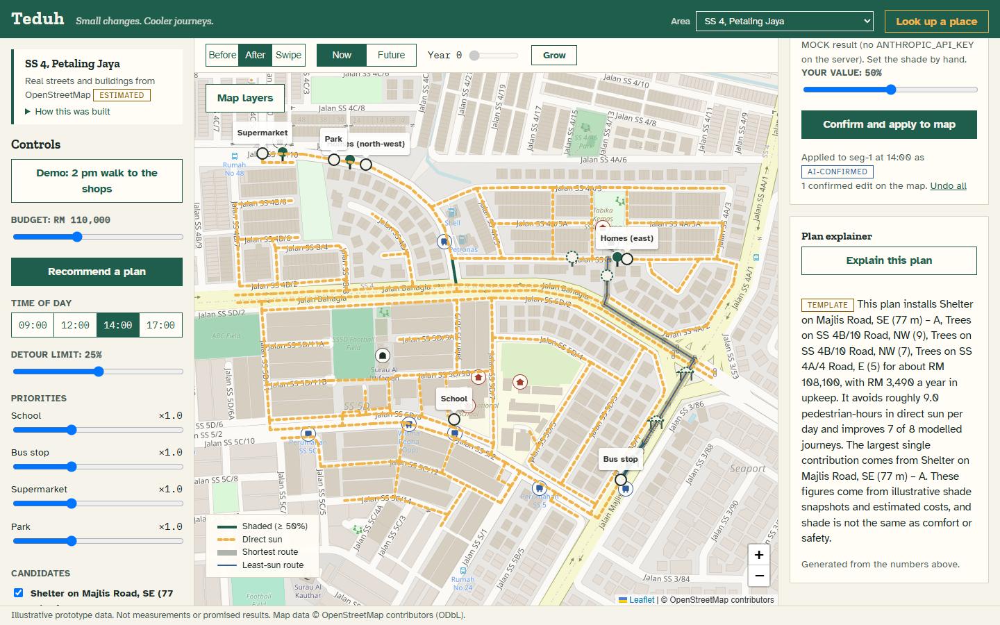
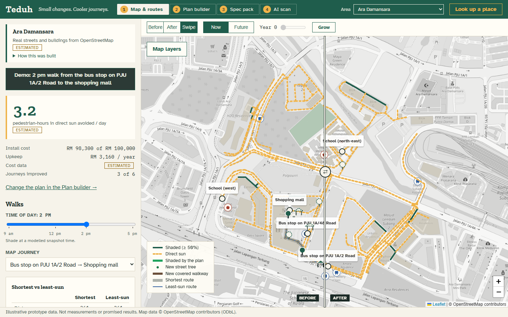

# TEDUH

> **Small changes. Cooler journeys.**
> A map that shows a township where its next ringgit of shade, a tree row or a covered walkway, helps the most people walking every day.

*Teduh* is Malay for shaded or sheltered. TEDUH is our entry to the **Sime Darby Property University Hackathon 2026, "Township of Tomorrow"** (Planet track, climate resilience).

A township can have trees and footpaths and still leave exposed gaps between them. A township manager has a small budget and no way to see which gap matters most. TEDUH answers one question:

> *"With our budget, which shade improvements would help the most everyday walks?"*

It models walks from train stations and bus stops to the places people go, finds the stretches in direct sun, tests every affordable mix of tree rows and covered walkways, and recommends the plan that takes the most walking time out of direct sun. Then it shows the change on the map and hands the maintenance team a build pack.

**Pitch material** (in [`pitch/`](pitch/)):

| File | What it is |
|---|---|
| [`TEDUH-pitch-deck.pptx`](pitch/TEDUH-pitch-deck.pptx) | 10 main slides + appendix. Speaker notes hold each presenter's lines and timestamps |
| [`TEDUH-demo-guide.pdf`](pitch/TEDUH-demo-guide.pdf) | Illustrated step-by-step guide: a screenshot of every demo click with the target highlighted, plus each slide and its lines |
| [`TEDUH-demo-script.docx`](pitch/TEDUH-demo-script.docx) | The timed script (Steven presents, Thien Gen demos), first-time setup, recovery steps and Q&A |
| [`demo-script.md`](pitch/demo-script.md) / [`run-sheet.html`](pitch/run-sheet.html) | The same script as Markdown and as a phone-friendly page |
| [`resident-interviews.md`](pitch/resident-interviews.md) | Interview questions and the log for real resident quotes |

## Screenshots

Real streets, buildings and places from OpenStreetMap (SS 15, Subang Jaya, the default area). Shade, trips and costs are **modelled estimates**; see "How this was built" in the app.

**Before / after swipe.** The recommended plan for RM 100,000: one covered walkway from the LRT station and two tree rows. Amber dashed lines are paths in direct sun; green is shade.



**Now / future canopy.** Young trees give little shade today and a lot at maturity, so the best plan changes with the growth year.



**Spec pack.** Dimensions, a priced bill of materials, an elevation drawing and CSV/JSON export for every tree row and walkway. Indicative only.



**AI shade scan.** A survey photo gets a shade estimate from a vision model (local or Claude). It reaches the map only after a person confirms it. The line at the top says whether the AI is ready on this laptop, and if not, the exact step that fixes it.



**Plan explainer.** A written summary built only from the numbers on screen. A check rejects any summary that invents a figure.



**Any place.** 15 Klang Valley areas are built in, and **Look up a place** builds any other area from OpenStreetMap in about 40 seconds. Shown: Sime Darby Property's Ara Damansara.



## Quick start

Needs Node 20 or newer.

```bash
git clone https://github.com/evan-2005/Teduh.git
cd Teduh
npm install
copy .env.example .env      # Windows. Mac/Linux: cp .env.example .env
npm run dev                 # app on http://localhost:5173
npm run dev:server          # AI scan + explainer API on :8787 (second terminal)
```

For a demo, use the production build. It proxies `/api` to the server the same way:

```bash
npm run build
npm run preview        # http://localhost:4173
```

The app opens on **SS 15, Subang Jaya** with the best plan applied. Click **Demo: 2 pm walk from the LRT station to the shopping mall** to reset to the demo scenario.

### Turning on the AI

The template `.env` already turns the AI on with a free local model. You still need three things the repo cannot ship:

1. **A `.env` file.** It is never committed (it can hold an API key), so copy `.env.example` as above.
2. **The model.** Install [Ollama](https://ollama.com), start it, then run `ollama pull qwen2.5vl:7b` (about 6 GB).
3. **The AI server.** Run `npm run dev:server` in a second terminal and leave it running.

Then run the checkup. It says what is missing and how to fix it:

```bash
npm run check:ai
```

`.env` settings, if you want something other than the default:

| Option | `.env` | Notes |
|---|---|---|
| **Local model** (what the demo uses) | `AI_PROVIDER=ollama`, `OLLAMA_MODEL=qwen2.5vl:7b` | Install [Ollama](https://ollama.com), then `ollama pull qwen2.5vl:7b`. No key, no cost per call, photos stay on the laptop. The first call loads the model (30–60 s). Model choice for a 6 GB GPU: [`docs/LOCAL-AI.md`](docs/LOCAL-AI.md) |
| **Claude** | `ANTHROPIC_API_KEY=...` | Server-side only; never prefix it with `VITE_` |
| **Neither** | (nothing) | The server returns clearly labelled `MOCK` results, so the demo never breaks |

The UI says which model made each estimate.

#### If the AI does not work on your laptop

| What you see | Why | Fix |
|---|---|---|
| No **4 AI scan** tab | `.env` is missing, or `VITE_ENABLE_AI` is not `true` | Copy `.env.example` to `.env`. Restart `npm run dev` (or `npm run build` again before `npm run preview`): the setting is read at start-up |
| "The AI server is not running" | `npm run dev:server` is not running | Start it in a second terminal, in the project folder |
| "Ollama is not running" | Ollama is not installed or not started | Install it from ollama.com and open it (Windows: Start menu → Ollama) |
| "The model … is not downloaded" | The model in `OLLAMA_MODEL` is not pulled | `ollama pull qwen2.5vl:7b`, or set `OLLAMA_MODEL` to a vision model you already have |
| Results marked **MOCK** | No AI is configured, or the model call failed (the note says why) | Run `npm run check:ai` |
| Very slow, then MOCK | The model is running on the CPU, or the first call is loading it | Plug in the charger and close other GPU apps. On a laptop with less than 6 GB of graphics memory use `gemma3:4b`. On a slow machine, raise `OLLAMA_TIMEOUT_MS` |

After changing `.env`, restart `npm run dev:server`; it reads the file once at start-up.

## What the app does

The map stays on screen; four pages sit beside it.

| Page | What you do there |
|---|---|
| **1 Map & routes** | Load the demo, read the headline (pedestrian-hours in direct sun avoided per day; **How is this number worked out?** shows the formula with this plan's numbers, walk by walk), compare walks before and after, change the time of day |
| **2 Plan builder** | Set the budget, recommend a plan, compare the best plan with cheaper options, edit tree spacing, species and unit costs, tick candidates, or **place your own** tree row or walkway on the map. Under **Who walks where**, describe who lives here and **Suggest settings** proposes a detour limit and destination weights, each with a reason, for you to apply or undo; or set the weights (×0 to ×5) yourself |
| **3 Spec pack** | Build details for one item: drawing, bill of materials, cost, CSV/JSON |
| **4 AI scan** | Upload a path photo, review and adjust the AI's shade estimate, confirm it onto the map; get a written plan summary |

Above the map: **Before / After / Swipe**, **Now / Future** with a growth-year slider and **Grow**, and **Map layers** (streets, light, satellite, none, plus buildings, parks, trees and landmarks).

## How it works

All the maths is in pure functions in `src/lib/`, with tests.

- **Shade** (`shade.ts`). Each path segment has a shaded fraction at 09:00, 12:00, 14:00 and 17:00, modelled from the real sun position and mapped buildings (`data/osm/shade.ts`). Times in between are interpolated. A confirmed AI estimate overrides the modelled value. A chosen tree row or walkway raises shade on its segments; trees grow along a smoothstep curve to maturity, walkways are full shade on day one.
- **Walks** (`data/osm/trips.ts`, `destinations.ts`). Walks start at rail stations and bus stops and end at malls, supermarkets, schools, clinics, places of worship and parks. Rail stations are scaled to real Prasarana ticket-gate exits from data.gov.my; the split between places is a gravity estimate.
- **Routes** (`routing.ts`, `metrics.ts`). Dijkstra on length for the shortest route. For the least-sun route, a sweep of weights (λ = 10 → 0) on `length × (1 + λ × sun)` returns the first route within the detour limit (25% by default). Each route reports walk time, minutes in direct sun and the longest exposed stretch.
- **Headline** (`headline.ts`). The figure is unweighted, so priorities never inflate it:

  ```
  pedestrian-hours avoided per day = Σ over walks [ trips per day × (sun-minutes before − sun-minutes after) ] ÷ 60
  sun-minutes on a walk           = Σ over path pieces [ length ÷ 72 m per min × (1 − shade) ]
  ```

  In the SS 15 demo: 592 trips × (3.05 − 1.95) min on the station-to-mall walk, plus four smaller walks, is 759 min ÷ 60 = 12.7.
- **Suggested settings** (`lib/suggestSettings.ts`, `server/suggest.ts`). The AI sees only your description and the destinations with their modelled trips per day, and is told not to invent demographics or weight a place just because it is busy. Its reply is snapped to the slider ranges and any health, safety or temperature claim is removed. Without an AI it falls back to simple, labelled keyword rules (for example "older residents" → clinic ×2 and a 15% detour).
- **Optimiser** (`optimizer.ts`). Tries every subset of up to 12 candidates (at most 4,096) that fits the budget. Score = Σ trips per day × priority × sun-minutes avoided. Shade overlaps count once, because every walk is recomputed with the combined plan. It returns the best plan plus cheaper alternatives that are not dominated, and how much each item adds.
- **Spec pack** (`features/fabrication/spec.ts`). Walkways: 3 m modules, two posts per grid line, a footing per post, polycarbonate roof. Tree rows: pit, soil mix, root barrier, guard, stakes, sapling and two years of upkeep. Unit costs are in `data/unit-costs.json` and editable in the app.

Data sources and the pipeline that builds each area: [`data/README.md`](data/README.md).

## Project structure

```
data/
  areas/<slug>/          shipped areas (neighbourhood, journeys, interventions, context JSON)
  osm/                   OpenStreetMap pipeline: parse, network, shade, trips, candidates
  seed/                  small invented area, the offline test fixture
  rail-ridership.json    station exits from data.gov.my
  unit-costs.json        unit costs and suggested tree species
server/                  Hono API: /api/health, /api/shade-scan, /api/explain
  provider.ts            picks Claude, Ollama or mock
  claude.ts, ollama.ts   the two model back ends; prompts.ts holds the prompts
  status.ts              is the AI ready on this laptop? (GET /api/status, npm run check:ai)
src/
  components/            map, layers, controls and the four page views
  features/ai-scan/      AI scan panel, plan explainer, API client
  features/fabrication/  spec pack, elevation drawing, CSV/JSON export
  lib/                   shade, routing, metrics, optimiser, planner, planting layout
  data/                  dataset loading, area picker, place lookup
  store/                 Zustand store (scenario, user-placed items)
pitch/                   deck, demo script, run sheet, interviews
scripts/screenshots.mjs  end-to-end check and README screenshots
docs/                    local AI guide, screenshots, archive of build-phase notes
```

## Scripts

| Command | What it does |
|---|---|
| `npm run dev` | App with hot reload on :5173 |
| `npm run dev:server` | AI API on :8787 |
| `npm run build` / `npm run preview` | Type-check, build, and serve the build on :4173 |
| `npm test` | All unit and integration tests (Vitest) |
| `npm run coverage` | Coverage for `src/lib/` |
| `npm run check:ai` | Checks this laptop's AI setup (`.env`, Ollama and the model, the AI server) and says how to fix what is missing |
| `npm run screenshots` | Drives the running app in Edge, runs about 40 end-to-end checks and saves `docs/screenshots/` (needs both servers running) |
| `npm run data:areas` | Rebuild the shipped areas from OpenStreetMap (see `data/README.md`) |
| `npm run data:ridership` | Refresh station exits from data.gov.my |

## Environment

| Variable | Default | Purpose |
|---|---|---|
| `VITE_ENABLE_AI` | `true` in the template | Show the AI scan and plan explainer. Read at start-up and at build time |
| `ANTHROPIC_API_KEY` | (unset) | Use Claude for the AI features. Server only |
| `AI_PROVIDER` | `ollama` in the template | `ollama` for a local model; remove it to use Claude |
| `OLLAMA_URL` | `http://localhost:11434` | Ollama server |
| `OLLAMA_MODEL` | `qwen2.5vl:7b` in the template (`gemma3:4b` if unset) | Must support images for the shade scan |
| `OLLAMA_TIMEOUT_MS` | `60000` | How long to wait for the local model |
| `VITE_DATASET` | (unset) | `seed` forces the invented area (the tests use this) |

`.env` is git-ignored; `.env.example` is committed.

## Honesty rules

These hold in the UI and the pitch:

- Shade is not comfort or safety. Never claim a temperature drop or call a route "safe" or "healthy".
- Every number shows its source: `surveyed`, `estimated`, `ai-confirmed` or `missing`.
- AI results never reach the map without a person clicking Confirm; mock results carry a `MOCK` badge.
- Spec packs are indicative and need a qualified engineer's sign-off and site checks.
- OpenStreetMap has few trees mapped in the Klang Valley, so modelled midday shade is understated. A field survey (and the AI scan) fills that gap.

## Contributing

- Run `npm test && npm run build` before you push.
- Keep functions under 50 lines and files under 400. Use immutable updates, named constants and no `console.log`.
- New maths goes in `src/lib/` as pure functions with tests. `src/types.ts` is the shared data contract.
- If you change the data, run the demo once and update the ◆ numbers in `pitch/demo-script.md`, `pitch/run-sheet.html` and the deck.

## Sources

- Map data © [OpenStreetMap](https://www.openstreetmap.org/copyright) contributors (ODbL).
- Rail ridership: Prasarana, via [data.gov.my](https://data.gov.my) (CC BY 4.0).
- Open Government Products, *Undercover*, Hack for Public Good (2026): <https://www.hack.gov.sg/2026/undercover/>
- Schrodi et al., *Climate-sensitive Urban Planning through Optimization of Tree Placements* (2023): <https://arxiv.org/abs/2310.05691>
- *CoolWalks for active mobility in urban street networks*, Scientific Reports (2025): <https://www.nature.com/articles/s41598-025-97200-2>

Product brief: [`BRIEF.md`](BRIEF.md). Build-phase notes: [`docs/archive/`](docs/archive/).

*Illustrative prototype. Shade and trips are modelled, not measured.*
